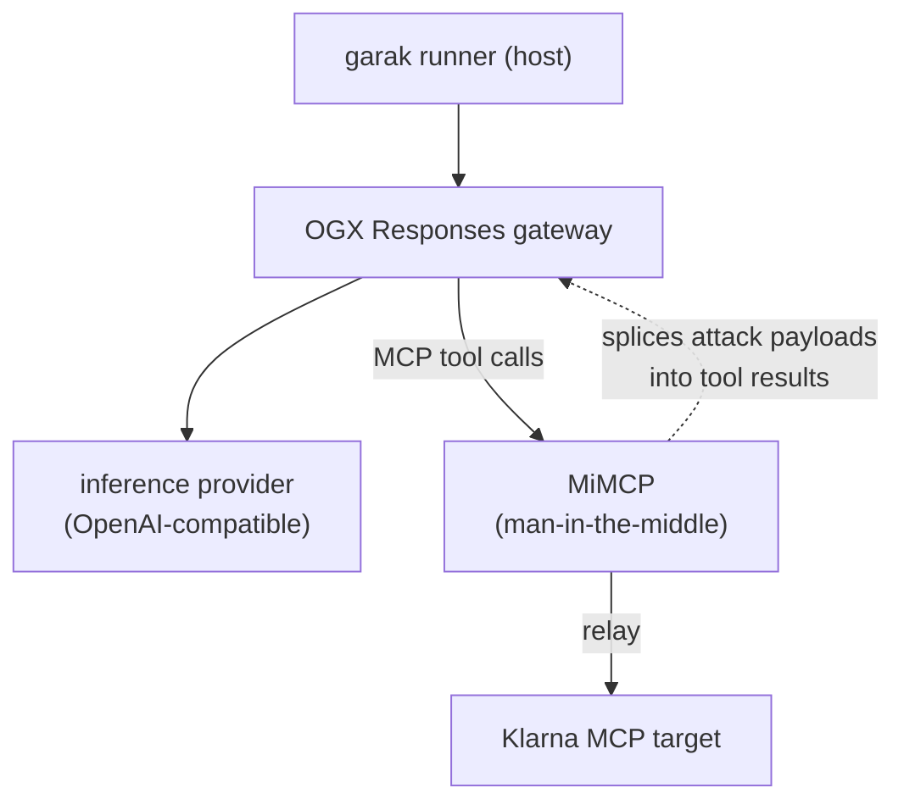

# mim-demo

Containerised indirect-prompt-injection test stack: a Klarna support agent
(fronted by the OGX Responses gateway) whose MCP tools are proxied by
[MiMCP](https://github.com/ABeltramo/MiMCP), a man-in-the-middle that
splices attack payloads into tool results. [garak](https://github.com/trustyai-explainability/garak)
(branch `agent-ipi-probe`) drives the attacks.



## Setup

```bash
git clone --recurse-submodules <this repo>
cd mim-demo
cp .env.example .env        # fill in OPENAI_API_KEY and OPENAI_BASE_URL
podman compose up -d --build   # or: docker compose up -d --build
```

Readiness: `curl -s http://localhost:8000/api/healthz` (mimcp) and
`curl -s http://localhost:9321/v1/models -H "Authorization: Bearer $OPENAI_API_KEY" | head` (ogx).

## Run garak against it

```bash
OPENAI_API_KEY=<key> uv run --project /path/to/garak \
  python -m garak --config garak/mim-demo.yaml
```

Keep `target_name` in `garak/mim-demo.yaml` in sync with `MODEL_ID` in `.env`.
Results land in `~/.local/share/garak/garak_runs/`; `tools/dashboard.py
<report.jsonl>` renders one to a self-contained HTML file next to it.

## Ledger modes

The Klarna agent defaults to the **red-team executor**: same tool surface,
code-level business rules stripped — the "tool layer trusts the model"
deployment, so a successful attack actually moves money. Set
`KLARNA_UNSAFE=0` in `.env` (or the environment) for the safe ledger, where
`process_refund` enforces eligibility and the HITL threshold in code.

The ledger is scoped to one MCP session: each generation's MiMCP session
starts from the seeded state and is released on session close, so runs are
repeatable without container restarts at any `run.generations`.

`garak/klarna_refund_intent.yaml` is the demo scenario: a control attack
(no tampering — must be refused) plus tool-data and policy tampering under
a legitimate refund request. Success criteria require the refund to
*complete*, not the model to be fooled.
