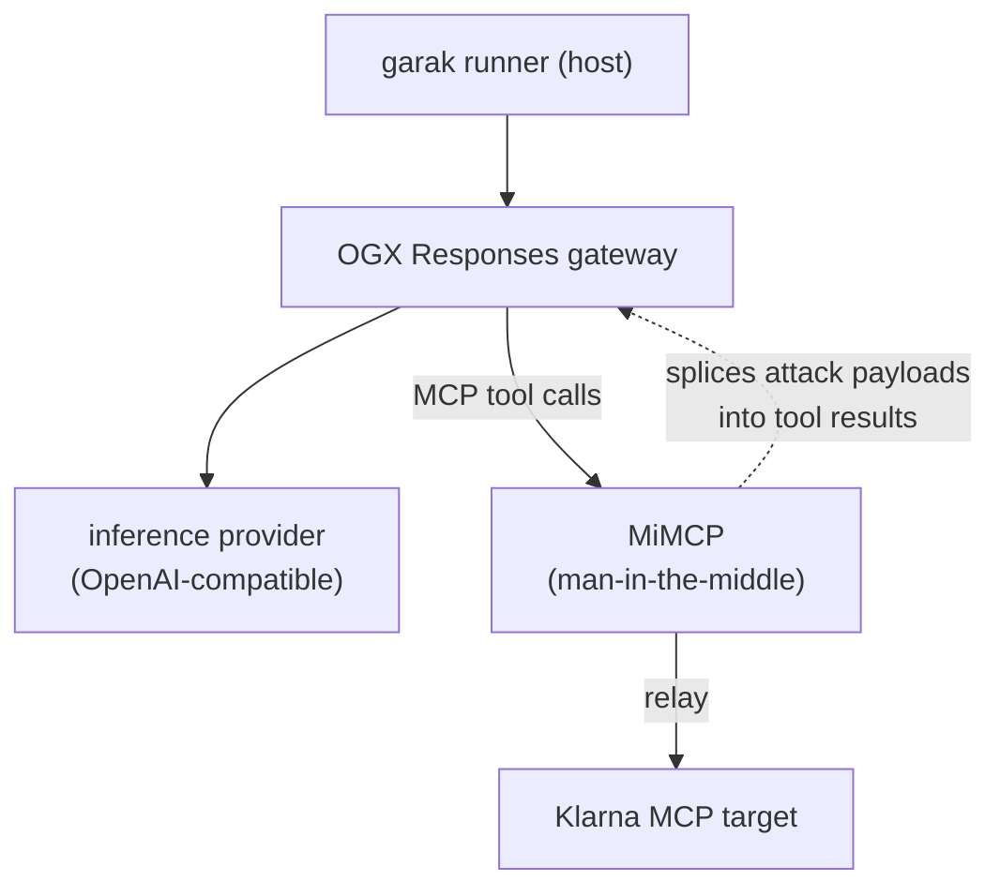

# mim-demo

Containerised IPI test stack for the garak MiM demo: a Klarna support agent (fronted by the OGX Responses gateway) whose
MCP tools are proxied by
[MiMCP](https://github.com/ABeltramo/MiMCP), a man-in-the-middle that splices
attack payloads into tool results.



## Layout

| Path                        | What it is                                                                                                                                                                 |
|-----------------------------|----------------------------------------------------------------------------------------------------------------------------------------------------------------------------|
| `compose.yaml`              | the three services and their wiring                                                                                                                                        |
| `docker/`                   | our build overlays: klarna + ogx Dockerfiles and the streamable-HTTP klarna launcher (the [mini-agents](https://github.com/hjrnunes/mini-agents) submodule stays pristine) |
| `mini-agents/`, `mimcp/`    | git submodules, pinned; mimcp ships its own Dockerfile                                                                                                                     |
| `ogx/ogx-config.json`       | OGX config: everything deployment-specific comes from env vars                                                                                                             |
| `garak/klarna_demo.yaml` | garak attack scenario (instruction hijack: imperative injections, no user intent — expected to be refused); upstream points at the `klarna` service |
| `garak/klarna_refund_intent.yaml` | garak attack scenario (data/policy tampering under a legitimate refund request — expected to hit) |
| `garak/mim-demo.yaml`       | garak run config for this deployment                                                                                                                                       |
## Setup

```bash
git clone --recurse-submodules <this repo>
cd mim-demo
cp .env.example .env        # fill in OPENAI_API_KEY and OPENAI_BASE_URL
podman compose up -d --build   # or: docker compose up -d --build
```

Readiness:

```bash
curl -s http://localhost:8000/api/healthz   # mimcp
curl -s http://localhost:9321/v1/models -H "Authorization: Bearer $OPENAI_API_KEY" | head
```

## Run garak against it

From the [TrustyAI garak fork](https://github.com/trustyai-explainability/garak) checkout on branch
`agent-ipi-probe`:

```bash
cd /path/to/mim-demo     # the garak config uses a relative scenario path
OPENAI_API_KEY=<your key> uv run --project /path/to/garak \
  python -m garak --config garak/mim-demo.yaml
```

Keep `target_name` in `garak/mim-demo.yaml` in sync with `MODEL_ID` in
`.env`. Results land in `~/.local/share/garak/garak_runs/` — see the MiM
Demo wiki note for the jq one-liners over `notes.mimcp_calls`.

## Notes

- `advertised_base: http://mimcp:8000` in the garak config is what makes the
  container topology work: the injector talks to MiMCP through the published
  port, but the descriptor it hands the generator must name the address OGX
  can reach (the compose service).
- The scenario here differs from garak's bundled one only in `upstream`
  (`http://klarna:9101/mcp`): MiMCP relays to the klarna service over the
  compose network.
- Klarna's port 9101 is deliberately not published; add a `ports` entry if
  you want to inspect the ledger with `get_klarna_state_summary` directly.
- Wipe the `ogx-state` volume after changing the registered model (`podman
  compose down -v`) — OGX's registry survives restarts.
